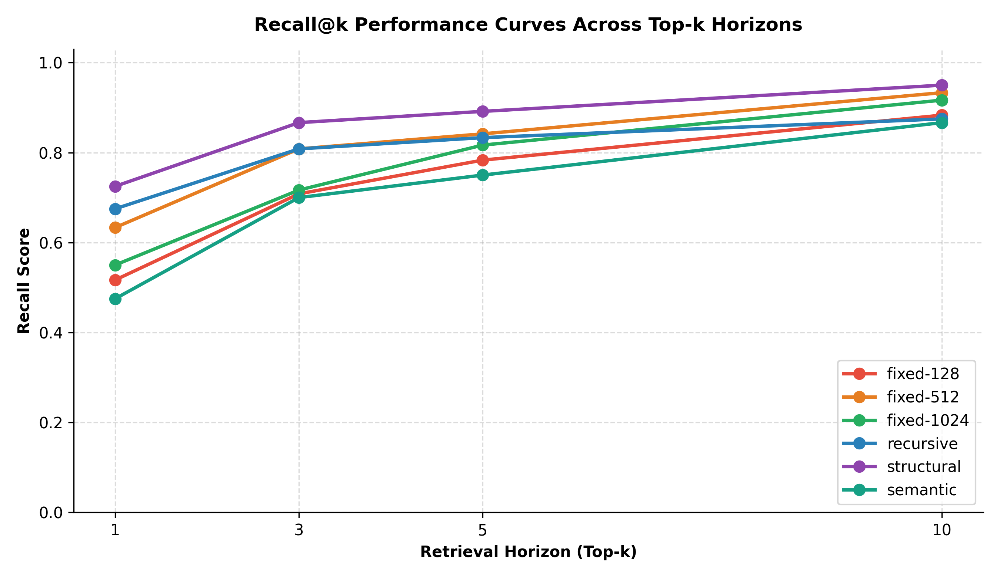
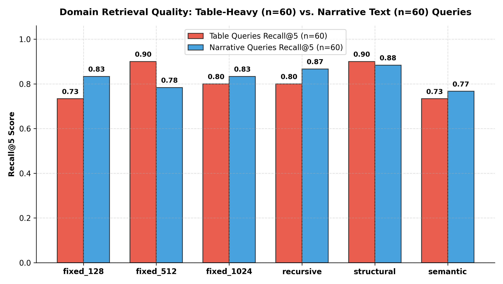
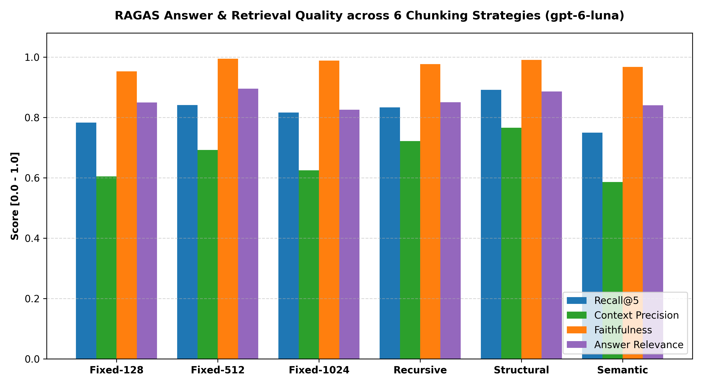
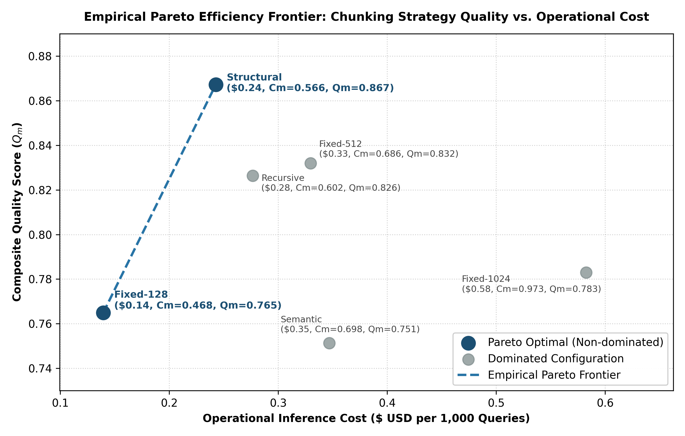
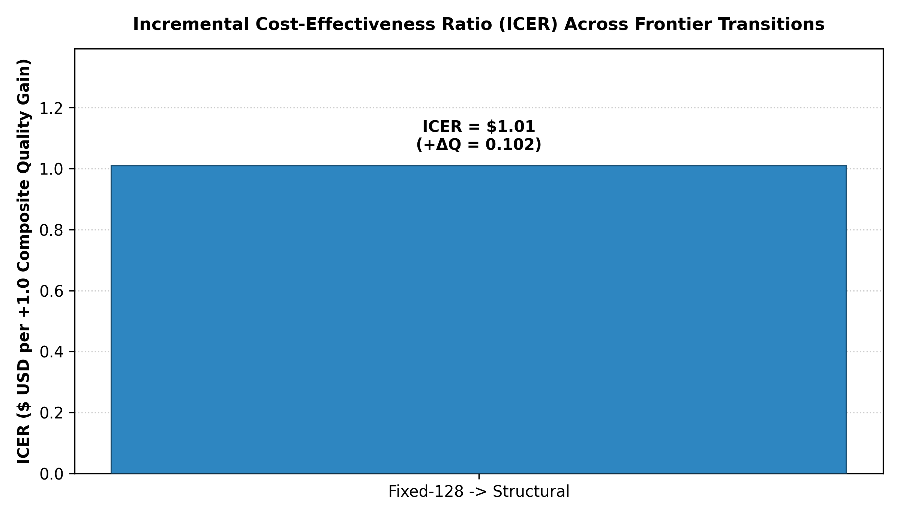
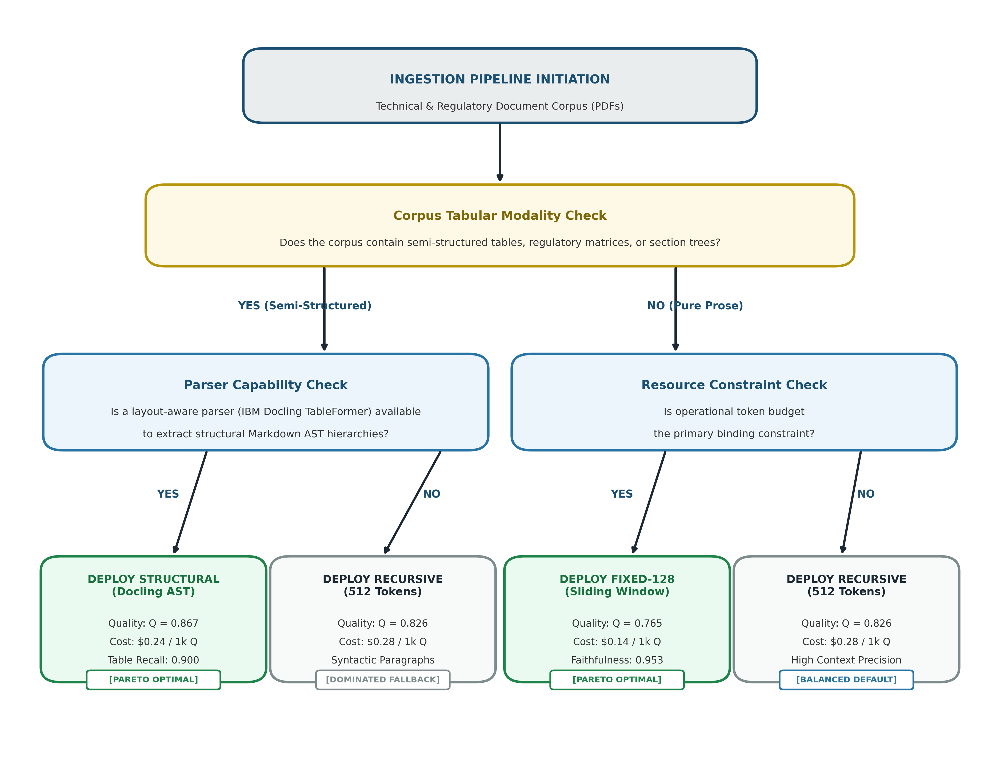

# Chunking Strategy Comparison for RAG Systems: A Cost-Quality Trade-off Analysis in Domain-Specific Document Retrieval

**Author:** Viktor Kakhno  
**Institution:** Technical University of Applied Sciences Würzburg-Schweinfurt (THWS)  
**Degree Programme:** Business and Engineering (B.Eng.)  

---

## 1. Overview & Experimental Architecture

This repository contains the complete, reproducible experimental pipeline, stratified 120-query benchmark dataset, Docling-converted Markdown corpus (115 technical & regulatory PDFs), raw evaluation logs (720 runs), aggregated metrics, and publication-grade figures (300 DPI) for the Bachelor's Thesis:

> **"Chunking Strategy Comparison for RAG Systems: A Cost-Quality Trade-off Analysis in Domain-Specific Document Retrieval"**

### Core Methodological Guarantees (Invariance Controls)
1. **Standardized Layout-Aware PDF Conversion (`IBM Docling v2.32`)**: All **115 PDF documents** (`24,088,389` characters, **`2,246` reconstructed Markdown tables** comprising `27,773` tabular rows across 4 technical & regulatory domains) are parsed into normalized Markdown Abstract Syntax Trees (AST) using Docling's neural layout analysis and `TableFormer` recognition prior to segmentation.
2. **Strictly Stratified 120-Query Benchmark (`50% Table / 50% Narrative`)**: Exactly **120 ground-truth queries** (**60 `table_numeric`** and **60 `narrative_text`**; `4 domain categories × 6 query subtypes × 5 queries = 120`).
3. **Unified Dense Embedding Model (`text-embedding-3-small`)**: OpenAI `text-embedding-3-small` (`1,536` dimensions, cosine similarity, `$0.02 / 1M tokens`) is held strictly invariant across **both** sentence-level semantic breakpoint detection (in `Semantic` chunking) **and** vector database indexing/retrieval (in ChromaDB v0.6.3) across all 6 strategies.
4. **Pure Bi-Encoder Retrieval (`No Re-ranker`)**: Top-$k$ cosine similarity search ($k \in \{1, 3, 5, 10\}$) is evaluated directly on the ChromaDB HNSW index without cross-encoder re-ranking to isolate the true representational quality of each chunking strategy.
5. **Unified Generator & Full Top-5 Context RAGAS Judge (`gpt-6-luna`)**: Both answer synthesis and reference-free RAGAS evaluation (`Faithfulness`, `Answer Relevance`, and `Context Precision`) are executed using OpenAI `gpt-6-luna` (`reasoning_effort="low"`, strict JSON schema output) supplied with the **complete Top-5 retrieved context (`Full Top-5 Context`)** without character truncation.
6. **Official API Token Economics**: Evaluated under official `gpt-6-luna` pricing (**`$0.10 / 1M` input tokens**, **`$0.50 / 1M` output tokens**) and `text-embedding-3-small` pricing (**`$0.02 / 1M` embedding tokens**).

---

## 2. Evaluated Chunking Strategies

| Strategy Alias | Target Window Size | Token Overlap | Boundary Delimiters & Thresholds | Table Handling Mechanism | Implementation Engine |
| :--- | :--- | :--- | :--- | :--- | :--- |
| **Fixed-128** | 128 tokens | 20 tokens (15%) | Fixed token intervals | Cut indiscriminately | `tiktoken` sliding window (`cl100k_base`) |
| **Fixed-512** | 512 tokens | 77 tokens (15%) | Fixed token intervals | Cut indiscriminately | `tiktoken` sliding window (`cl100k_base`) |
| **Fixed-1024** | 1024 tokens | 205 tokens (20%) | Fixed token intervals | Cut indiscriminately | `tiktoken` sliding window (`cl100k_base`) |
| **Recursive** | 512 tokens | 77 tokens (15%) | `["\n\n", "\n", ". ", " "]` | Syntactic delimiter cascade | `RecursiveCharacterTextSplitter` (LangChain) |
| **Structural** | 512 target / 800 max | 0 tokens (0%) | Markdown headings (`#`, `##`, `###`) | Indivisible atomic blocks + breadcrumbs | Docling AST Layout Parser (`TableFormer`) |
| **Semantic** | 80–600 tokens | 0 tokens (0%) | 90th percentile cosine distance | Cut at sentence breaks | OpenAI `text-embedding-3-small` (1536-d) |

---

## 3. Empirical Results Summary (720 Evaluation Runs)

### 3.1 Corpus Ingestion Footprint & Resource Utilization (115 Documents)

| Strategy | Total Chunks | Avg Tokens/Chunk | Median Tokens | Table Chunks | Ingestion Time (s) | Peak RAM (MB) | ChromaDB Storage (MB) | Ingestion Cost ($) |
| :--- | ---: | ---: | ---: | ---: | ---: | ---: | ---: | ---: |
| **Fixed-128** | 44,812 | 127.9 | 128.0 | 10,660 | 18.15 s | 103.3 MB | 262.6 MB | $0.115 |
| **Fixed-512** | 11,152 | 509.8 | 512.0 | 3,448 | 9.45 s | 50.0 MB | 65.3 MB | $0.114 |
| **Fixed-1024** | 5,931 | 1016.4 | 1024.0 | 2,235 | 8.23 s | 49.6 MB | 34.8 MB | $0.121 |
| **Recursive** | 12,710 | 404.3 | 450.0 | 1,928 | 29.76 s | 50.9 MB | 74.5 MB | $0.103 |
| **Structural** | **18,345** | **271.8** | **221.0** | **2,718** | **20.05 s** | **52.6 MB** | **107.5 MB** | **$0.100** |
| **Semantic** | 11,659 | 411.1 | 409.0 | 1,642 | 282.49 s | 869.3 MB | 68.3 MB | $0.188 |

---

### 3.2 Information Retrieval Performance Across Cutoffs ($k \in \{1, 3, 5, 10\}$)

| Strategy | Recall@1 | Recall@3 | Recall@5 | Recall@10 | MRR | Mean Token IoU | Table Recall@5 ($n=60$) | Narrative Recall@5 ($n=60$) | Modality Disparity ($\Delta$) |
| :--- | ---: | ---: | ---: | ---: | ---: | ---: | ---: | ---: | ---: |
| **Fixed-128** | 0.517 | 0.708 | 0.783 | 0.883 | 0.633 | 0.520 | 0.733 | 0.833 | -10.0% |
| **Fixed-512** | 0.633 | 0.808 | 0.842 | 0.933 | 0.735 | 0.365 | **0.900** | 0.783 | +11.7% |
| **Fixed-1024** | 0.550 | 0.717 | 0.817 | 0.917 | 0.659 | 0.251 | 0.800 | 0.833 | -3.3% |
| **Recursive** | 0.675 | 0.808 | 0.833 | 0.875 | 0.748 | 0.420 | 0.800 | 0.867 | -6.7% |
| **Structural** | **0.725** | **0.867** | **0.892** | **0.950** | **0.801** | **0.605** | **0.900** | **0.883** | **+1.7%** |
| **Semantic** | 0.475 | 0.700 | 0.750 | 0.867 | 0.611 | 0.327 | 0.733 | 0.767 | -3.3% |





---

### 3.3 Granular Query Subtype Breakdown (Recall@5, $n=20$ per Subtype)

| Strategy | Exact Cell Lookup (Tab) | Cross-Column Comparison (Tab) | Range & Threshold (Tab) | Scope & Definition (Narr) | Procedural Steps (Narr) | Regulatory Obligations (Narr) |
| :--- | ---: | ---: | ---: | ---: | ---: | ---: |
| **Fixed-128** | 0.800 | 0.800 | 0.600 | 0.850 | 0.850 | 0.800 |
| **Fixed-512** | 0.900 | 0.900 | **0.900** | 0.800 | 0.700 | **0.850** |
| **Fixed-1024** | 0.800 | 0.800 | 0.800 | 0.900 | 0.800 | 0.800 |
| **Recursive** | 0.800 | 0.850 | 0.750 | 0.900 | 0.850 | **0.850** |
| **Structural** | **0.950** | **0.900** | 0.850 | **0.950** | **0.900** | 0.800 |
| **Semantic** | 0.700 | 0.700 | 0.800 | 0.900 | 0.700 | 0.700 |

---

### 3.4 Generative Answer Quality (RAGAS Framework — Full Top-5 Context)

*Note: Answer Quality Score ($	ext{AQS} = rac{F + AR}{2}$) represents the composite arithmetic mean of Faithfulness ($F$) and Answer Relevance ($AR$).*

| Strategy | Context Precision | Faithfulness (Overall) | Table Faithfulness ($n=60$) | Narrative Faithfulness ($n=60$) | Answer Relevance | Answer Quality Score (AQS) | Avg Top-5 Prompt Tokens |
| :--- | ---: | ---: | ---: | ---: | ---: | ---: | ---: |
| **Fixed-128** | 0.605 | 0.953 | 0.915 | **0.992** | 0.850 | 0.902 | 639.9 |
| **Fixed-512** | 0.692 | **0.995** | **1.000** | 0.990 | **0.896** | **0.945** | 2,542.0 |
| **Fixed-1024** | 0.625 | 0.989 | 0.987 | 0.990 | 0.826 | 0.907 | 5,071.1 |
| **Recursive** | 0.722 | 0.977 | 0.967 | 0.988 | 0.851 | 0.914 | 2,012.2 |
| **Structural** | **0.766** | 0.991 | 0.993 | 0.990 | 0.886 | 0.939 | 1,672.8 |
| **Semantic** | 0.586 | 0.968 | 0.959 | 0.976 | 0.841 | 0.904 | 2,713.8 |



---

### 3.5 Multi-Objective Cost-Quality Trade-Off, Pareto Frontier & ICER Analysis

- **Composite Quality Index ($Q_m$)**:
  $$Q_m = 0.20 \cdot 	ext{Recall@5} + 0.20 \cdot 	ext{MRR} + 0.20 \cdot 	ext{Context Precision} + 0.20 \cdot 	ext{Faithfulness} + 0.20 \cdot 	ext{Answer Relevance}$$
- **Composite Operational Cost Score ($C_m$)**:
  $$C_m = 0.70 \cdot rac{	ext{Cost}_m}{\max(	ext{Cost})} + 0.30 \cdot rac{	ext{Latency}_m}{\max(	ext{Latency})}$$

| Strategy | Composite Quality ($Q_m$) | Operational Cost ($/1k Queries) | Exact Cost ($/1k) | Query Latency (ms) | Composite Cost ($C_m$) | Pareto Status | ICER ($\Delta	ext{Cost} / \Delta Q_m$) |
| :--- | ---: | ---: | ---: | ---: | ---: | :--- | :--- |
| **Fixed-128** | **0.765** (`0.7649`) | **$0.14** | `$0.1395` | 1,450 ms | **0.468** | **Pareto Optimal (Baseline)** | Baseline (`$0.18 / +1.0 Q_m`) |
| **Structural** | **0.867** (`0.8672`) | **$0.24** | `$0.2428` | 1,328 ms | **0.566** | **Pareto Optimal (Global Max)** | **`$1.01 per +1.0 Q_m`** |
| **Recursive** | 0.826 (`0.8264`) | $0.28 | `$0.2767` | **1,301 ms** | 0.602 | *Dominated by Structural* | N/A (Dominated) |
| **Fixed-512** | 0.832 (`0.8319`) | $0.33 | `$0.3297` | 1,402 ms | 0.686 | *Dominated by Structural* | N/A (`-$2.46 / Q_m` vs Structural) |
| **Semantic** | 0.751 (`0.7513`) | $0.35 | `$0.3469` | 1,357 ms | 0.698 | *Dominated by Fixed-128 & Structural* | N/A (Dominated) |
| **Fixed-1024** | 0.783 (`0.7830`) | $0.58 | `$0.5826` | 1,319 ms | 0.973 | *Dominated* | N/A (`-$4.04 / Q_m` vs Structural) |







---

## 4. Repository Structure

```text
rag-chunking-benchmark/
├── config.py                         # Central configuration, model constants, pricing & paths
├── 01_build_balanced_dataset.py      # Stage 1: Stratified 120-query dataset builder (60 Table / 60 Narrative)
├── 02_chunking_engine.py             # Stage 2: All 6 chunkers (Fixed-128/512/1024, Recursive, Structural AST, Semantic)
├── 03_vector_store.py                # Stage 3: ChromaDB HNSW vector indexing & retrieval via text-embedding-3-small
├── 04_run_benchmark_and_ragas.py     # Stage 4: 720-run IR + RAGAS evaluation suite via gpt-6-luna (Full Top-5 Context)
├── 05_generate_charts_and_report.py  # Stage 5: 300-DPI publication figures & summary report generator
├── run_all.py                        # Master end-to-end execution script
├── requirements.txt                  # Python dependencies
├── .env.example                      # Environment variable template
├── .gitignore                        # Clean Git ignore rules
├── data/
│   ├── evaluation_dataset_120_balanced.json  # 120 ground-truth benchmark queries with gold passages & key facts
│   ├── evaluation_dataset_120_balanced.csv   # Tabular export of the 120 benchmark queries
│   ├── processed_markdown/                   # All 115 Docling-parsed Markdown documents across 4 categories
│   └── sentence_embeddings_cache/            # Cached OpenAI sentence cosine distances for deterministic Semantic chunking
├── results/
│   ├── unified_benchmark_summary.json        # Consolidated metrics across all 6 strategies
│   ├── unified_benchmark_summary.csv         # CSV summary of all retrieval, RAGAS, cost & Pareto metrics
│   ├── chunking_summary.json                 # Offline ingestion, RAM, chunk counts & token statistics
│   ├── chunking_summary.csv                  # CSV export of offline ingestion metrics
│   ├── vector_store_summary.json             # ChromaDB collection indexing statistics
│   ├── subtype_breakdown_summary.csv         # Granular Recall@5 across the 6 query subtypes & 4 categories
│   ├── pareto_icer_summary.csv               # Pareto frontier classification & ICER calculations
│   ├── raw_720_evaluation_runs.json          # Complete per-query log of all 720 evaluation runs
│   └── UNIFIED_BENCHMARK_REPORT.md           # Automated Markdown benchmark report
└── figures/
    ├── figure_4_1_recall_curves.png          # Recall@k trajectories (300 DPI)
    ├── figure_4_2_ragas_breakdown.png        # Generative RAGAS metrics breakdown (300 DPI)
    ├── figure_4_3_table_vs_narrative.png     # Modality disparity: Tables vs. Narrative text (300 DPI)
    ├── figure_4_4_pareto_frontier.png        # Empirical Pareto Efficiency Frontier (300 DPI)
    ├── figure_4_5_icer_breakdown.png         # Incremental Cost-Effectiveness Ratio (ICER) chart (300 DPI)
    └── figure_5_1_decision_tree.png          # Enterprise architectural decision flowchart (300 DPI)
```

---

## 5. Reproducibility & Quick Start

### 1. Environment Setup
```bash
pip install -r requirements.txt
cp .env.example .env
# Edit .env and insert your OPENAI_API_KEY
```

### 2. Regenerate All Figures & Summary Tables from Existing 720 Runs (Instant, No API Calls Needed)
```bash
python 05_generate_charts_and_report.py
```

### 3. Run the Full End-to-End Pipeline from Scratch
```bash
python run_all.py
```
